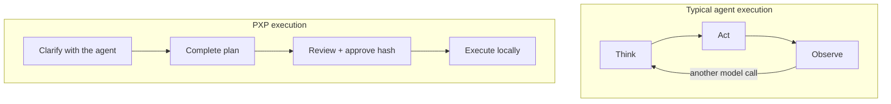

# PXP — Plan eXecution Protocol

> **Think with the agent. Execute without it.**

PXP is the handoff from AI reasoning to local execution.

Use your coding agent to investigate the repository, challenge assumptions, and remove ambiguity. When the task is fully understood, have the agent encode the entire change—patches, commands, and checks—in one YAML plan. Review it, approve its exact SHA-256, and let PXP run it.

No model calls between steps. No waiting for the agent to rediscover what it already decided. No tokens spent narrating a plan that is already complete.

**The model does the thinking. PXP does the doing.**

[Get started](#quick-start) or [see exactly where PXP fits](#where-pxp-fits).

## Where PXP fits

Many coding agents work in a loop: think, act, observe, ask the model what to do next. That loop is valuable while the solution is still being discovered. Once every material decision has been made, the same loop becomes latency and token overhead.

PXP replaces that execution loop with a finite, reviewable path:



| | Iterative agent execution | PXP |
|---|---|---|
| Model role | Reasons throughout the run | Reasons before the run |
| Execution | Repeated think → act → observe cycles | One approved plan, applied in order |
| Adaptation | Can change course after every result | Stops on failure; never improvises |
| Best fit | Exploration and unresolved work | Well-defined, fully planned work |

PXP is not a replacement for agentic exploration. It is what comes after exploration has done its job.

## Start at the top of the hill

Software development happens in the decisions before the keystrokes. AI did not change that. If the goal, constraints, or failure behavior are unclear, execution is premature—whether the code is written by a person or a model.

[Basecamp's Hill Charts](https://basecamp.com/hill-charts) give this a useful shape:

```text
                    COMPLETE PLAN
                         ▲
                        / \
     unknowns          /   \          known work
     clarify          /     \         execute
     with AI         /       \        with PXP
                    /         \
             UNKNOWN → KNOWN → DONE
```

Uphill work is about finding the approach and resolving unknowns. At the summit, there are no unsolved problems left: you can see the path down. Downhill work is execution.

**PXP starts at the summit.**

Use PXP when:

- the outcome and acceptance criteria are explicit;
- the agent has inspected the repository and resolved material questions;
- every intended patch, command, and verification can be written down;
- you want to approve the whole change before any of it runs.

Keep the agent in the loop when:

- the request is an open-ended question or investigation;
- product, design, or architecture choices are still unsettled;
- the next step depends on learning from the previous one;
- you expect the implementation to improvise.

If the work is still uphill, clarify it. If the path is visible, encode it once and run it.

## Why PXP feels fast

### Execution starts when you approve

One command verifies the plan and begins the work. PXP does not pause between patches and commands for model replies. The commands themselves still take as long as they take; the agent latency is what disappears.

### Tokens go to decisions, not ceremony

PXP makes no model calls during execution. You spend model tokens while reasoning improves the plan, not while a model repeatedly observes and confirms work that was already specified.

If a plan fails, PXP stops. Inspect the workspace, resolve the new uncertainty, and produce a new complete plan. PXP never hides adaptation inside execution.

### You approve the complete change

A PXP plan contains every patch and shell command that will run. Before the first step starts, PXP can bind your approval to:

- the SHA-256 of the exact plan file;
- the exact Git commit used during planning.

If either value changes, PXP stops before it runs a plan step.

## How it works

```text
CODING AGENT                 YOU                         PXP

inspect the repository       review the complete plan    verify the plan hash
resolve ambiguity      →     inspect every step     →    verify the Git commit
write plan.pxp.yaml          approve one SHA-256          apply steps in order
stop planning                                             make no model calls
```

The agent is present during planning. It is not present during execution. PXP applies the approved steps in order and stops at the first failure; it does not adapt the plan after execution starts.

## Quick start

### 1. Check the requirements

PXP supports:

- macOS 12 or later;
- Linux with kernel 3.2 or later;
- Linux under WSL.

You also need Git 2.24 or later and Bash 3.2 or later. Native Windows shells are not supported.

### 2. Install PXP

Download the installer from the latest GitHub Release. Read it before you run it.

```sh
curl -fsSLO https://github.com/otar/pxp/releases/latest/download/install.sh
less install.sh
bash install.sh
```

The installer verifies the release checksum and installs `pxp` into `~/.local/bin` by default. See the [installation guide](docs/installation.md) for pinned versions, custom locations, upgrades, and removal.

To build from the current source instead, use Go 1.25 or later:

```sh
make build
./bin/pxp version
```

### 3. Connect your coding agent

PXP includes instruction-only skills for Codex and Claude Code. These commands install a skill for your user from this repository checkout.

For Codex:

```sh
mkdir -p "$HOME/.agents/skills/pxp"
cp integrations/codex/skills/pxp/SKILL.md "$HOME/.agents/skills/pxp/SKILL.md"
```

For Claude Code:

```sh
mkdir -p "$HOME/.claude/skills/pxp"
cp integrations/claude-code/skills/pxp/SKILL.md "$HOME/.claude/skills/pxp/SKILL.md"
```

See [agent integrations](docs/integrations.md) for repository-level installation and more details.

### 4. Ask the agent for a plan

In Codex:

```text
$pxp Implement the requested change and compile it into a complete PXP plan.
```

In Claude Code:

```text
/pxp Implement the requested change and compile it into a complete PXP plan.
```

The skill lets the agent inspect the repository. The agent writes only `plan.pxp.yaml`, reports its hash, and stops. It does not edit source files or run PXP.

### 5. Review and run

Read the complete plan. Check every patch and command.

```sh
less plan.pxp.yaml
```

Calculate the SHA-256 yourself after the review:

```sh
# Linux
sha256sum plan.pxp.yaml

# macOS
shasum -a 256 plan.pxp.yaml
```

Copy the reviewed hash into the command as a fixed value:

```sh
pxp run --expect-sha256 COPY_THE_REVIEWED_64_CHARACTER_HASH_HERE plan.pxp.yaml
```

Do not calculate the hash inside the `pxp run` command. Approval and execution must remain separate.

PXP checks the hash before it opens the repository. It checks the expected Git commit while it holds the worktree lock. A mismatch stops execution before the first plan step.

## Plan format

Agent integrations create PXP 1.1 plans for you. A plan has a name, an exact Git commit, and an ordered list of steps.

Use the complete output of `git rev-parse --verify 'HEAD^{commit}'` for `repository.head`.

```yaml
pxp_version: "1.1"
name: Add a greeting
repository:
  type: git
  head: 0123456789abcdef0123456789abcdef01234567
steps:
  - name: Add the file
    patch: |
      diff --git a/hello.txt b/hello.txt
      new file mode 100644
      --- /dev/null
      +++ b/hello.txt
      @@ -0,0 +1 @@
      +hello from PXP
  - name: Verify the file
    run:
      - test "$(cat hello.txt)" = "hello from PXP"
```

Each step contains one patch or a list of shell commands. PXP executes steps in document order and stops at the first failure.

## What PXP checks

Before the first plan step, PXP:

- reads and validates the complete plan;
- compares the plan with the approved SHA-256 when you use `--expect-sha256`;
- verifies the exact Git commit for a PXP 1.1 plan;
- obtains a lock for the current worktree;
- rejects tracked workspace changes unless you use `--allow-dirty`;
- checks patch structure, paths, and file types.

PXP runs each command in a fresh, strict, non-interactive Bash process at the worktree root. State such as `cd` or a shell variable does not continue into the next command. File changes do continue.

PXP itself makes no model call, update check, telemetry request, DNS lookup, or other network request during execution. A command in a trusted plan can use the network.

## Trust model

> [!WARNING]
> A PXP plan is a trusted program. It can run arbitrary shell commands with your user permissions. Review every plan before you run it.

PXP is an executor, not a sandbox. It does not make unsafe commands safe. Plan commands inherit most of your environment and can read files, print secrets, or contact external services.

PXP does not roll back. If a later step fails, earlier commands and patches remain. Commit or stash important work before execution. Use `--allow-dirty` only when you understand how the plan interacts with existing changes.

The plan hash identifies the exact approved file. Git binding identifies the expected starting commit. These checks do not freeze untracked files, external services, time, network responses, or changes from unrelated processes.

Follow the [security policy](SECURITY.md) and the [recovery guide](docs/recovery.md) for more information.

## CLI reference

```text
pxp run [--allow-dirty] [--expect-sha256 HASH] <plan.pxp.yaml|->
pxp help [run|version]
pxp version
pxp -h
pxp --help
pxp --version
```

Use `-` to read a plan from standard input. A plan file must be a regular file and must not be a symbolic link. Child commands do not receive the plan stream as interactive input.

Lifecycle messages go to standard error. Command output passes through without reformatting. PXP reports command numbers but does not print command contents.

| Exit code | Meaning |
|---:|---|
| `0` | Success |
| `2` | CLI usage error |
| `3` | Input, schema, or patch-policy error |
| `4` | Environment or repository precondition error |
| `5` | Command or patch execution failure |
| `70` | Internal error |
| `130` | Interrupted by `SIGINT` |
| `143` | Terminated by `SIGTERM` |

## Learn more

- [Installation and upgrades](docs/installation.md)
- [Codex and Claude Code integrations](docs/integrations.md)
- [PXP specification](SPEC.md)
- [PXP 1.1 JSON Schema](schema/pxp-v1.1.schema.json)
- [Troubleshooting](docs/troubleshooting.md)
- [Recovery after a failed plan](docs/recovery.md)
- [Benchmark framework](benchmark/README.md)
- [Security policy](SECURITY.md)
- [Contributing](CONTRIBUTING.md)
- [Release process](RELEASING.md)

The benchmark framework compares direct agent execution with PXP execution on reproducible fixtures. Its results apply only to the tested task, agent, model, and environment.

PXP is available under the [MIT License](LICENSE).
